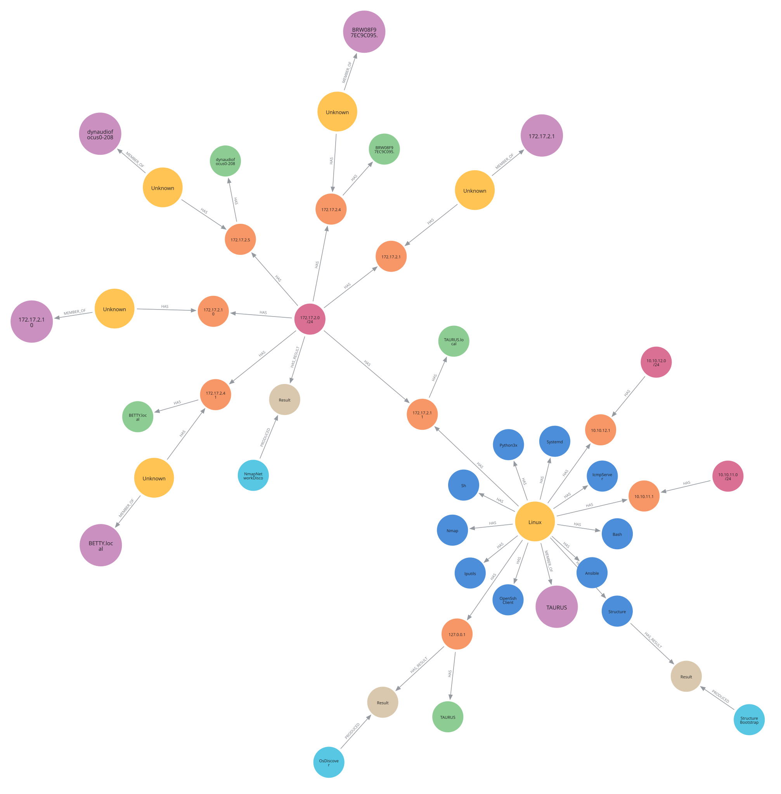

# Structure

Structure is a systems management platform in which capabilities emerge from an
environment's components and their relationships. You request a capability, such
as `Start` or `Execute`, but you don't need to say "how". Structure then uses
its model to select and combine the tools needed to perform the capability,
including the full command construction, transport, and result collection.

The backend of Structure is a property graph stored in Neo4j. In the graph you
can find things like Operating systems, services, addresses and installed tools,
and abstract things like types, protocols, capabilities and instruments.

For example, the `Start` capability for a remote service can combine a service
manager, a command interpreter and available command transfer client/server
tools on two hosts. Structure uses the graph to select these parts and assemble
the steps to transfer and run the command. The `Start` capability can use
different interpreters and transports without a separate implementation for each
combination.

A `Detect` capability updates the graph with discovered components and
relationships, which can make further, new capabilities available. Bundles
supply type definitions, schemas, discovery profiles and instruments, together
with command templates and scripts. Support for new tools and services can build
on existing definitions and execution mechanisms without changes to the Java
backend.

The following section starts with giving a short explanation about how these
[capabilities](#capabilities) work, and then continues with showing you how to
[build](#building) Structure, how to [run](#running) it, how to do some
[example](#examples) commands, how to [query](#querying) the graph, and finally
how to run our [tests](#testing).

## Capabilities

Structure initially defines these capabilities:

| Capability      | Purpose                                                    |
| --------------- | ---------------------------------------------------------- |
| `State`         | Check the state of an entity.                              |
| `Start`         | Start an entity.                                           |
| `Stop`          | Stop an entity.                                            |
| `Restart`       | Restart an entity.                                         |
| `Create`        | Create related entities.                                   |
| `Destroy`       | Destroy an entity or its children.                         |
| `Execute`       | Run commands.                                              |
| `Detect`        | Detect a component.                                        |
| `List`          | List child entities.                                       |
| `Identify`      | Identify details such as a name or version.                |
| `SendString`    | Send a string over a protocol.                             |
| `ReceiveString` | Receive a string over a protocol.                          |
| `SendFile`      | Send a file over a protocol.                               |
| `ReceiveFile`   | Receive a file over a protocol.                            |
| `Invoke`        | Invoke a command for execution.                            |
| `Verify`        | Check whether an entity's type is correct.                 |
| `Show`          | Return an entity's current graph representation.           |
| `Update`        | Verify and identify an entity, then update the graph.      |
| `Guess`         | Infer an abstract entity that cannot be detected directly. |

Capabilities can work together to perform an operation. For example, `Execute`
runs a command, and `Invoke` lets an interpreter run a script. To run a command
on a (remote or local) subject, Structure can combine them as follows:

0. Structure executes a query between the source and target systems to figure
   out what they have. What they have gives you a list of capabilities that you
   can run.
1. An `Execute` instrument puts a command you want to run in a template.
2. An `Invoke` instrument, such as `BashInvoke`, wraps the command in a script.
3. A `SendFile` instrument transfers the script, and a `SendString` instrument
   sends a command to run it. The subject must have matching receive
   capabilities for the protocols used.

Other operations, such as `Start` (starting a service, or a virtual machine, or
a container), can use the same interpreter and transport capabilities. Structure
selects compatible instruments from the graph and combines them through its
execution logic.

## Requirements

To build and run Structure, you need:

- [Maven](https://maven.apache.org/download.cgi) to build, and to run tests.
- [Java](https://adoptium.net/) 25 or later, to compile and run the code.
- [Python](https://www.python.org/) on the Structure host, to run bootstrap
  and the network, address and OS discovery instruments.
- [Ansible](https://docs.ansible.com/) on the Structure host, for OS discovery.
  Note that its `setup` module needs Python 2 or Python 3 on remote hosts.
- [Nmap](https://nmap.org/) on the Structure host, for network and address
  scanning and discovery.
- [Docker](https://docs.docker.com/get-docker/) to run the integration tests,
  and (optionally) to run a Neo4j container image.
- [Neo4j](https://neo4j.com/download/) (optional, you can also use Docker). You
  need version 5.19 or later. Used to store the Structure graph.
- [Node.js](https://nodejs.org/) 22.19 or later, to run the REPL. The REPL needs
  no other packages.
- [jq](https://jqlang.org/), to read fields of the JSON that the REPL writes, as
  in the [examples](#examples).

## Building

Build the jar without the tests (see [Testing](#testing)). The below will result
in `target/structure-*-fat.jar`:

```bash
mvn package -DskipTests
```

## Running

To run Structure, first start Neo4j and then Structure itself.

### Neo4j

Structure needs a Neo4j server; let's start one using Docker:

```bash
docker run -d --rm --name neo4j -p 7474:7474 -p 7687:7687 \
  -e NEO4J_AUTH=neo4j/structure --tmpfs /data --tmpfs /logs \
  --tmpfs /plugins \--tmpfs /import --tmpfs /var/lib/neo4j/run \
  neo4j:latest
```

### Structure Backend

Specify the Neo4j database password and start Structure:

```bash
export STRUCTURE_NEO4J_PASS=structure
java -jar target/structure-*-fat.jar --unsafe
```

### REPL

The REPL in `repl/` sends requests to the event bus of Structure. Node.js must
trust the certificate of Structure:

```bash
cd repl
export NODE_EXTRA_CA_CERTS=../target/structure.crt
node src/main.ts
```

Without arguments, the REPL starts a shell. Each line is a command:

```text
<target>.<handler> [--<option> <value>]...
```

For example `repository.types.findOneByName --name Linux`. The REPL gets the
targets, the handlers and the options from the `introspect` handler. A new
handler on the event bus is a new command in the REPL:

- The target is a bus address without the `tech.raaf.structure.bus.` prefix,
  for example `manager.structuremanager`, `repository.types` or `node.<uuid>`.
  A type also has its hierarchy path as a target, for example:
  `node.type.component.software.operatingsystem.unixlike.linux`.
- The options are the properties of the argument schema of a handler. A boolean
option has no value: `--includeStart` or `--no-includeStart`. For an array, give
  the option again for each item. A value that is not a string is JSON, for
  example `--entities '{"name": "Linux", ...}'`.
- Each target has a `help` handler: `repository.types.help` gives the help of
  each handler of `repository.types`, and something like
  `repository.types.help --handler getAll` shows the help of `getAll`.

In the shell, Tab completes targets one part at a time, then handlers and
options. Ctrl-C clears the line, and Ctrl-D ends the shell. Events, for example
of a bootstrap, show above the prompt.

With arguments, the REPL runs one command, for example:
`node src/main.ts repository.types.getAll`. It writes the data to `stdout`, and
events and errors to `stderr`. If the command fails, the exit code is `1`.

The REPL connects to `wss://localhost:8443/eventbus/websocket`. Set
`STRUCTURE_URL` to use a different bridge.

## Examples

These examples use the [REPL](#repl), from the `repl/` directory.

To get information about Structure, you can run the following command:

```bash
node src/main.ts manager.structuremanager.info
```

You can "bootstrap" Structure, which builds a representation of the machine
running Structure in the graph:

```bash
node src/main.ts manager.structuremanager.selfDiscovery
```

When the bootstrap is done, try running the `info` command again. You will see
that `bootstrapped` is now `true`, and the graph has a couple of components and
a component group extra:

```bash
node src/main.ts manager.structuremanager.info
```

If Ansible is available, the bootstrap also adds the IPv4 network of each
interface of the host. Find a network by its CIDR, for example `172.17.2.0/24`,
and put its UUID in an environment variable:

```bash
export UUID=$(node src/main.ts repository.instances.findOneByData \
  --property cidr --value 172.17.2.0/24 \
  | jq -r .meta.uuid)
echo $UUID
```

On an IP network, `Detect` uses `NmapNetworkDiscover`, which scans the network
with Nmap. The handler replies with a task ID and usually takes a few seconds
to run (30ish):

```bash
node src/main.ts node.$UUID.runCapability --capability Detect
```

To show what the scan did and what nodes in the graph it created, you can run
the following:

```bash
node src/main.ts node.$UUID.getResults | jq -r '.[0].stderr'
node src/main.ts node.$UUID.getComponentsByType --type Ipv4Address
```

## Querying

You can see the graph in a Neo4j Browser. Open https://browser.neo4j.io/, and
connect to `bolt://localhost:7687`. The user is `neo4j`, and the password is
the value of `STRUCTURE_NEO4J_PASS`.

The style sheet `notes/structure.grass` gives each kind of node a colour, for
example groups, software, IP addresses and networks, and shows the names of the
nodes.

To use it, run `:style` and use the **Upload** button. The resulting style page
does not update, but from experience, the styles *do* apply.

Here is an example Cypher query to show the instances and the relations between
them:

```cypher
MATCH p = (:Instance)-[]->(:Instance)
RETURN p
```

If the result shows a table, select the **Graph** view on the left side of the
result. Note that you can also double-click on nodes; they will then dynamically
expand and show more relations. In our graph, those are often Type relations.


_an example graph after self discovery and network discovery have executed_

## Testing

To run regular unit tests:

```bash
mvn test
```

To run integration tests:

```bash
mvn integration-test
```

To run all of the above, including coverage report:

```bash
mvn verify
```

The tests write their output to one file for each test class. Unit tests write
to `target/surefire-reports`, and integration tests write to
`target/failsafe-reports`. The file name is the name of the test class followed
by `-output.txt`. Some tests cause failures on purpose, thus warnings and errors
in these files are not always a problem.

### REPL

To run the unit tests of the REPL:

```bash
cd repl
npm test
```

The integration tests of the REPL need a running Structure, at `STRUCTURE_URL`
or at the default bridge. Without it, these tests are skipped. They do not
change the graph:

```bash
NODE_EXTRA_CA_CERTS=../target/structure.crt npm run test:integration
```

The types in `repl/src/model` come from the JSON schemas in
`src/main/resources/schema`. After a change to these schemas, generate them
again, else the unit tests fail:

```bash
npm run model
```

To check the types, you need the TypeScript compiler, `tsc`, and the type
definitions of Node.js:

```bash
npm install
npm run check
```
